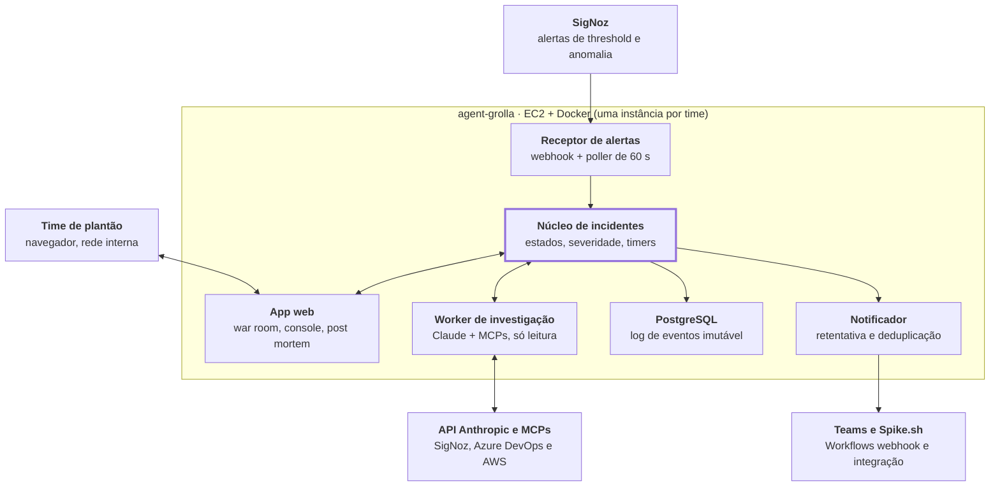
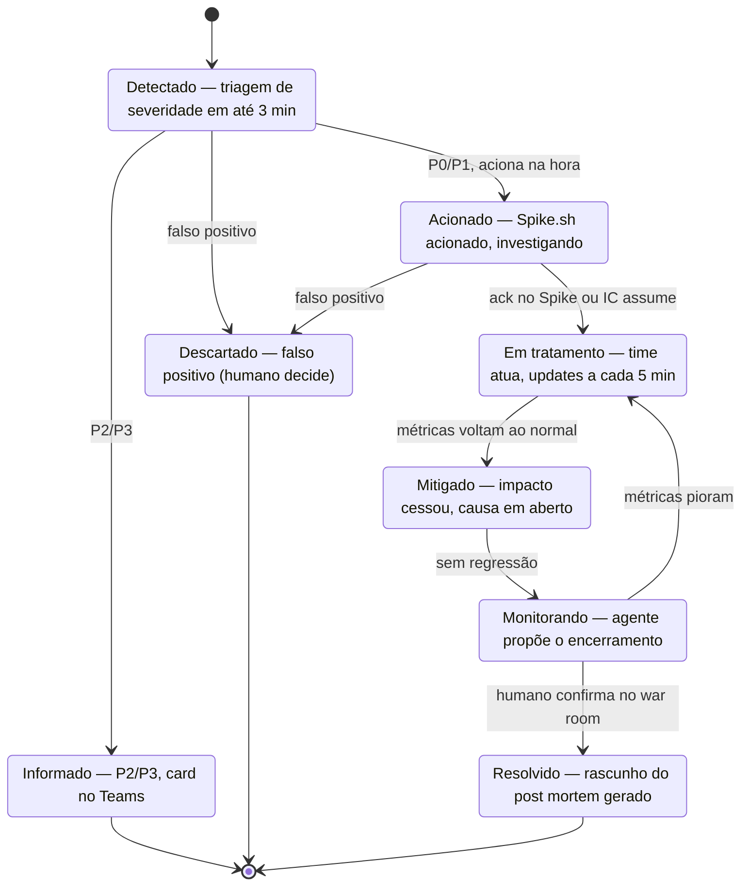
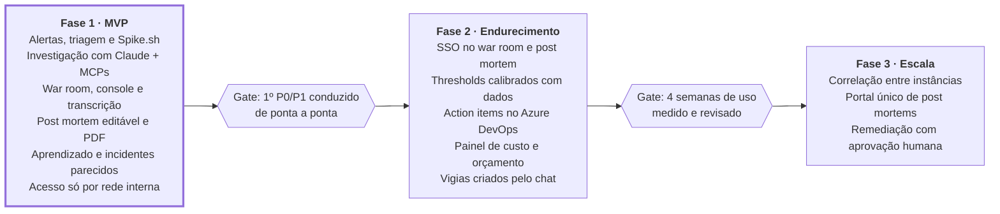

# agent-grolla — Spec inicial v0.1

24/10/2026 · Vinicius Machado Faleiro

## Visão geral

O agent-grolla é um agente de SRE que acompanha o ambiente de adquirência e cartões 24x7, detecta anomalias, investiga a causa, aciona o on-call e conduz o incidente até o post mortem. Ele atua como o primeiro respondente: chega antes do humano, organiza as evidências e mantém o registro de tudo o que acontece durante a crise.

## Objetivos

- Reduzir o TTD (tempo até detectar) e o TTA (tempo até acionar) de incidentes P0/P1 para poucos minutos.
- Entregar mais do que o alerta: todo alerta que chega ao canal vem com uma análise do agente (o que ele avaliou, hipóteses com evidência e um plano proposto), não só o aviso que o SigNoz já manda.
- Entregar ao on-call uma investigação já em andamento, com hipóteses ranqueadas e evidências.
- Manter um registro completo e auditável de cada incidente, sem esforço manual do time.
- Gerar o rascunho do post mortem automaticamente, para revisão e aprovação humana.
- Aprender com o tempo sobre o ambiente (infra, componentes, padrões, incidentes passados) e usar esse conhecimento para investigar melhor a cada incidente, inclusive avisando o time quando um problema parecido já aconteceu.

## Não-objetivos da v1

- Executar ações de remediação (rollback, restart, scale). O agente só sugere.
- Substituir o incident commander humano. O agente propõe; quem decide e encerra é uma pessoa.
- Detectar anomalias por conta própria via polling. A detecção estatística fica no SigNoz.

## Escopo da v1 e decisões tomadas

A v1 cobre todos os sistemas do time que faz o deploy do agente. **Todo alerta que vira incidente é investigado**: o valor do agente sobre o webhook que o SigNoz já manda para o Teams é chegar com a análise pronta. O acionamento automático do on-call é só para P0/P1. As decisões abaixo já foram fechadas e orientam o resto da spec.

| Tema | Decisão |
|---|---|
| Cobertura | Todos os sistemas (autorização, captura, liquidação, antifraude, APIs de lojistas etc.), rodando na AWS |
| Observabilidade | Tudo instrumentado no SigNoz (métricas, logs e traces via OpenTelemetry), mais leitura nas contas AWS para checar a saúde da infraestrutura quando necessário |
| Código e mudanças | Azure DevOps via MCP, lido sob demanda pelo agente |
| Gatilhos | Alertas do SigNoz (threshold e anomalia), recebidos por webhook |
| Tratamento por severidade | Todos: card "investigando" e card de análise inicial no Teams (o que avaliou, hipóteses e plano proposto, com botão para a página do incidente). P0/P1: além disso, investigação mais profunda, acionamento, war room com acompanhamento e updates |
| Acionamento | Spike.sh acionado automaticamente pelo agente desde o primeiro dia |
| Comunicação | Teams via webhook (Workflows) só para notificar; interação acontece no war room web |
| Interação humana | Chat com o agente dentro da página do incidente, mais upload de transcrição de call; e um console de chat geral para perguntas sobre a saúde do ambiente |
| Encerramento | O agente propõe o encerramento; um humano confirma |
| Autonomia | Somente leitura: o agente sugere ações, não executa |
| Deploy | Uma instância do agente por time, cada uma com seu canal do Teams |
| Stack | Python, Docker, EC2 |
| LLM | API da Anthropic (Claude), sem Bedrock |
| Dados sensíveis | Logs não contêm PAN; não há restrição para enviar logs e código ao LLM |
| Autenticação da página | SSO na fase 2 (obrigatório antes de ampliar o uso) |
| Orçamento de LLM | Indefinido no início; controlado por limites técnicos (ver [Segurança, custo e guardrails](#segurança-custo-e-guardrails)) |

## Arquitetura

O agent-grolla é um serviço Python em containers Docker numa EC2, com um núcleo determinístico que controla o incidente e um worker LLM que apenas investiga. Todo estado vive no PostgreSQL como log de eventos.

*Diagrama: o núcleo determinístico decide; o LLM só investiga.*



O núcleo é o único componente que muda estado, aciona o Spike.sh e decide o que vai para o Teams; o worker devolve hipóteses e o war room envia mensagens e ações humanas, ambos como eventos.

### Stack proposta

- **Linguagem:** Python 3.12.
- **API e war room:** FastAPI no backend; frontend simples servido pelo mesmo app (HTMX ou React leve), com atualização ao vivo por Server-Sent Events.
- **Agente:** Claude Agent SDK (Python) com os MCPs do SigNoz, do Azure DevOps e da AWS (servidores MCP oficiais da AWS, em modo somente leitura).
- **Jobs e timers:** worker assíncrono com fila no próprio Postgres (por exemplo, a lib `procrastinate`), sem precisar de Redis na v1.
- **Banco:** PostgreSQL 16 em container, volume EBS e backup diário para S3.
- **PDF:** geração a partir do HTML do post mortem (WeasyPrint).
- **Deploy:** `docker compose` com cinco serviços (api, worker, postgres, signoz-mcp, aws-mcp).

## Gatilhos e detecção

Todo incidente nasce de um alerta do SigNoz que chega ao agente por webhook. Os dois gatilhos pedidos (alarmes e mudanças bruscas em métricas) viram o mesmo tipo de evento: mudanças bruscas são configuradas no SigNoz como alertas de anomalia (desvio contra a baseline sazonal), e alarmes tradicionais como alertas de threshold.

### Fontes de alerta

- **Alertas de threshold** sobre métricas técnicas (erro, latência p95/p99, saturação, filas, consumo de recursos).
- **Alertas de anomalia** sobre SLIs de negócio: taxa de aprovação (total, por bandeira, emissor e MCC), TPS contra a baseline, timeouts com as bandeiras e falhas de captura e liquidação.

Como fallback, um poller leve chama a API de alertas do SigNoz a cada 60 s para recuperar alertas que o webhook tenha perdido. Não é um detector, só uma rede de segurança.

### Pipeline de entrada

1. O webhook recebe o alerta, valida um token compartilhado e grava o evento bruto (idempotente pelo fingerprint do alerta).
2. **Deduplicação:** o mesmo alerta disparando de novo atualiza o incidente existente em vez de criar outro.
3. **Agrupamento:** o agente tenta anexar o alerta a um incidente aberto (regras abaixo).
4. Se não agrupar, abre um incidente novo no estado **Detectado** e inicia a triagem de severidade.

### Regras de agrupamento (tenta agrupar primeiro)

O agrupamento roda em duas etapas, para ser rápido e barato na maioria dos casos:

1. **Regra determinística:** agrupa direto se o alerta é do mesmo `service.name` de um incidente aberto, ou de um serviço que é dependência direta dele no grafo de traces, dentro de uma janela de 15 minutos.
2. **Avaliação pelo LLM:** se a regra não decidir, um modelo rápido recebe o alerta novo e o resumo dos incidentes abertos e responde "agrupar no incidente X" ou "novo incidente", com justificativa.

Todo agrupamento fica registrado na timeline com o motivo. No war room, um humano pode desfazer (separar) ou forçar (juntar) incidentes.

## Severidade e acionamento

A severidade é decidida em até 3 minutos após a detecção, por regras de impacto de negócio, e P0/P1 acionam o Spike.sh imediatamente, sem esperar o fim da investigação. A investigação roda em paralelo e chega ao on-call já em andamento.

| Severidade | Critério (thresholds a calibrar) | Ação do agente |
|---|---|---|
| **P0** | Indisponibilidade total de um domínio (autorização, captura, liquidação etc.), queda de aprovação acima de X% no total, ou uma bandeira inteira fora | Spike.sh imediato, cards de investigação e análise, war room, investigação profunda, updates a cada 5 min |
| **P1** | Degradação parcial com risco de perda financeira: queda de aprovação num recorte (bandeira, emissor, MCC), latência de autorização perto do timeout da bandeira, falha de liquidação ou agenda | Spike.sh imediato, cards de investigação e análise, war room, investigação profunda, updates a cada 5 min |
| **P2** | Degradação sem impacto financeiro direto, ou componente redundante falhando | Cards "investigando" e de análise inicial, sem acionamento e sem updates periódicos |
| **P3** | Anomalia sem impacto visível ao cliente | Cards "investigando" e de análise inicial, sem acionamento e sem updates periódicos |

### Como a severidade é decidida

- Regras determinísticas, configuradas por time em YAML, mapeiam alertas e SLIs para P0–P3. Exemplo: `approval_rate_drop_pct > X por 3 min → P0`.
- Quando nenhuma regra casa, o LLM sugere a severidade com justificativa. Na dúvida entre dois níveis, o agente escolhe o mais alto.
- O agente pode propor reclassificação durante o incidente (subir ou descer). Subir para P0/P1 aciona o Spike.sh na hora; descer exige confirmação humana no war room.

### Impacto financeiro estimado

Para P0/P1, o agente calcula a cada ciclo o número de transações negadas ou perdidas acima da baseline e o TPV correspondente. Esse número aparece no card do Teams, no war room e no post mortem.

### Integração com Spike.sh

- Acionamento via webhook de integração do Spike.sh, com título, severidade, resumo, impacto estimado e o link do war room.
- Chave de deduplicação = id do incidente no agente, para que updates não gerem novos acionamentos.
- Quando um humano encerra o incidente no war room, o agente resolve o incidente no Spike.sh.
- **Proteção contra tempestade:** no máximo N acionamentos novos em 10 minutos por instância. Acima disso, o agente agrupa num único acionamento "múltiplos incidentes" e avisa no Teams.

## Ciclo de vida do incidente

Um incidente P0/P1 passa por seis estados, e o acionamento do on-call acontece logo na saída da triagem. A investigação é uma atividade contínua dentro de Acionado e Em tratamento, não um estado próprio.

*Diagrama: P0/P1 acionam o on-call antes de a investigação terminar.*



P2/P3 terminam em Informado; falsos positivos vão para Descartado por decisão humana; e um incidente em Monitorando volta para Em tratamento se as métricas piorarem.

### Regras de transição

- **Detectado → Acionado:** automático quando a severidade é P0/P1.
- **Acionado → Em tratamento:** ack no Spike.sh ou alguém assume como IC no war room.
- **Em tratamento → Mitigado:** o agente propõe quando os SLIs afetados voltam à baseline; um humano também pode marcar.
- **Mitigado → Monitorando:** automático após a confirmação da mitigação.
- **Monitorando → Resolvido:** o agente propõe após 15 minutos estáveis (configurável); só um humano encerra.

Cada transição grava o timestamp usado no cálculo de TTD, TTA, TTM e TTR.

## Investigação

A investigação é feita por um worker LLM por incidente, **para todo incidente, de qualquer severidade**, que usa os MCPs do SigNoz, do Azure DevOps e da AWS e devolve hipóteses estruturadas ao núcleo. O worker nunca altera estado diretamente: tudo o que ele produz vira evento no banco, e o núcleo decide o que fazer.

### Roteiro padrão de investigação

0. **Histórico:** buscar incidentes passados parecidos e o conhecimento já acumulado sobre os serviços afetados (ver [Aprendizado contínuo](#aprendizado-contínuo-e-memória-do-ambiente)). Se houver um caso parecido, a causa e a correção dele viram a primeira hipótese a confirmar ou descartar.
1. **Delimitar o impacto:** quais serviços, endpoints, bandeiras, emissores e lojistas foram afetados, e desde quando.
2. **Mudanças recentes:** deploys, PRs mergeados e pipelines no Azure DevOps nas últimas 2–6 horas dos serviços afetados e de suas dependências.
3. **Traces:** spans com erro ou lentidão, para localizar em que dependência o problema começa (banco, bandeira, serviço interno, fila).
4. **Logs:** padrões de erro novos ou que aumentaram, comparando com a mesma janela da semana anterior.
5. **Infraestrutura:** saturação de CPU, memória, conexões, filas e pods no SigNoz e, quando necessário, o estado dos recursos na AWS (AWS Health, alarmes do CloudWatch, RDS, ELB, EKS/ECS, quotas e eventos recentes no CloudTrail).
6. **Código, quando necessário:** leitura do trecho envolvido (stack trace, endpoint, mudança recente) via o mapeamento `service.name` → repositório.
7. **Síntese:** hipóteses ranqueadas, cada uma com evidências e ações sugeridas.

### Mapeamento serviço → repositório

Um arquivo de configuração por time liga cada `service.name` do OTel ao projeto e repositório do Azure DevOps (e opcionalmente ao caminho dentro de um monorepo). Sem entrada no mapa, o agente tenta achar o repo pelo nome e registra a sugestão de mapeamento para um humano confirmar.

### Saída estruturada de cada ciclo

Cada ciclo devolve um JSON validado com:

- resumo do estado atual;
- hipóteses (título, confiança 0–1, evidências com links para o SigNoz, ações sugeridas, como confirmar ou descartar);
- hipóteses descartadas com o motivo;
- estimativa de impacto;
- próximos passos do agente.

### Ciclos e acompanhamento

- **Análise inicial (todos os incidentes):** começa logo depois do card "investigando" e tem limite de tempo (padrão 5 minutos, configurável) e de tokens. O resultado vira o card de análise. P2/P3 param aqui.
- **A análise sempre chega.** Se o LLM falhar, estourar o tempo ou o orçamento, o agente posta o card de análise mesmo assim, como **parcial**: o que conseguiu avaliar, o que faltou e por quê. O time nunca fica só com o "investigando".
- **Investigação profunda (P0/P1):** continua depois da análise inicial, até 10 minutos ou até atingir confiança mínima numa hipótese, e atualiza o war room.
- **Acompanhamento:** a cada 5 minutos (configurável) para P0/P1, o worker revisita métricas e logs, atualiza hipóteses e verifica se as ações relatadas pelo time surtiram efeito.
- **Gatilho de mudança:** uma mensagem do time no chat, uma transcrição nova ou um alerta agrupado disparam um ciclo fora do intervalo.

### Modelos

Nenhum ID de modelo fica no código: cada etapa que chama o LLM lê modelo e parâmetros da seção `llm.stages` do YAML do time (ver [Configuração por deployment](#configuração-por-deployment)). Trocar de modelo é mudar config e reiniciar, sem deploy de código.

| Etapa (`stage`) | Uso | Padrão sugerido |
|---|---|---|
| `grouping` | Decidir se um alerta entra num incidente aberto | Claude Haiku 4.5 (`claude-haiku-4-5`) |
| `triage` | Sugerir severidade quando nenhuma regra casa | Claude Haiku 4.5 (`claude-haiku-4-5`) |
| `investigation` | Investigação inicial e ciclos de acompanhamento | Claude Sonnet 5.5 (`claude-sonnet-5-5`) |
| `warroom_chat` | Chat dentro do war room | Claude Sonnet 5.5 (`claude-sonnet-5-5`) |
| `transcript` | Extração de eventos da transcrição de call | Claude Sonnet 5.5 (`claude-sonnet-5-5`) |
| `console` | Console de operação (chat geral) | Claude Sonnet 5.5 (`claude-sonnet-5-5`) |
| `postmortem` | Rascunho e "regenerar seção" do post mortem | Claude Opus 5.5 (`claude-opus-5-5`) |

Regras da configuração:

- Cada etapa define `model` e, opcionalmente, `effort`, `max_tokens` e `cache_ttl`; o que não for definido herda de `llm.defaults`.
- **Override por severidade:** uma etapa pode trocar de modelo para P0 (por exemplo, `investigation` com Opus em P0 longos), via `overrides`.
- **Validação no startup:** o agente consulta a Models API para cada modelo configurado e só sobe se todos existirem e suportarem os parâmetros pedidos (por exemplo, `effort` não vale para o Haiku 4.5). Erro de config aparece no boot, não no meio de um incidente.
- Toda chamada grava em `llm_usage` a etapa e o modelo efetivamente usado, para comparar custo e qualidade entre configurações.

## Comunicação: Teams e war room

O Teams é o canal de notificação, e o war room web é onde o time interage com o agente. O webhook do Teams (Workflows do Power Automate) só envia mensagens; tudo o que precisa de resposta humana acontece na página do incidente.

### Mensagens no Teams (Adaptive Cards)

| Momento | Conteúdo do card |
|---|---|
| Investigando (todos) | Postado em segundos, antes de qualquer chamada ao LLM: "Identifiquei a anomalia X no serviço Y (evidência: alerta Z). Estou investigando." Severidade, serviços afetados, o que o agente vai checar e o botão **Abrir incidente** (página do incidente) |
| Análise inicial (todos) | O resultado da primeira investigação, no mesmo canal: **o que avaliei** (cada checagem com o resultado: métricas, logs, traces, deploys recentes, histórico), **hipóteses** ranqueadas (título, confiança, evidência com link para o SigNoz ou o Azure DevOps), **plano proposto** (próximos passos sugeridos ao time; o agente não executa nada) e os botões **Abrir incidente** e **Ver no SigNoz**. Se a análise for parcial, o card diz o que faltou |
| Já vi isso antes | "Isso parece o incidente #N de 12/09 (causa: pool de conexões do RDS esgotado; resolvido com restart do authorizer-api)." Link do incidente e do post mortem, e o grau de semelhança. Entra dentro da análise inicial quando o caso parecido é achado nela |
| Acionamento (P0/P1) | Confirmação de que o on-call foi acionado no Spike.sh e por quê |
| Update periódico (P0/P1, 5 min) | Status, o que mudou desde o último update, hipótese principal e confiança, impacto acumulado |
| Severidade elevada | Nova severidade e o motivo; se passou a P0/P1, a investigação profunda começa |
| Proposta de encerramento | Métricas normalizadas há N minutos; pedido de confirmação no war room |
| Normalizado / Encerramento | Duração, impacto final, link do rascunho do post mortem |

Para não poluir o canal único, os updates periódicos só são postados quando há mudança relevante (estado, hipótese principal, tendência do impacto). Sem mudança, o agente posta um update curto a cada 15 minutos dizendo que segue acompanhando.

### War room web (uma página por incidente)

- **Cabeçalho ao vivo:** estado, severidade, duração, impacto estimado, quem é o incident commander.
- **Timeline:** todos os eventos em ordem (alertas, ações do agente, mensagens, mudanças de estado), com autor.
- **Evidências:** gráficos e links profundos para o SigNoz e o Azure DevOps.
- **Hipóteses:** ranking atual, com evidências e o histórico das descartadas.
- **Chat com o agente:** o time pergunta, informa ações e corrige o agente. Cada mensagem vira evento na timeline.
- **Ações rápidas:** "assumo como IC", "fiz rollback de X", "descarta hipótese N", "mudar severidade", "separar/juntar incidente", "confirmar encerramento".
- **Transcrição de call:** upload de arquivo de texto (por exemplo, a transcrição do Teams). O agente extrai decisões, ações, horários e participantes, adiciona à timeline como eventos marcados "origem: transcrição" e reavalia as hipóteses.

### Identificação de autor na fase 1

Sem SSO na fase 1, a página pede um nome na primeira visita e guarda localmente. Isso permite registrar quem disse o quê, mas **não é autenticação**: a página deve ficar acessível só pela rede interna ou VPN até a fase 2.

## Console de operação (chat geral)

Além do war room de cada incidente, o app web tem um console onde qualquer pessoa do time conversa com o agente sobre a saúde do ambiente, sem precisar de um incidente aberto. É a mesma inteligência e as mesmas ferramentas de leitura, usadas sob demanda.

### Exemplos de perguntas

- "Como está o ambiente agora?": resumo dos golden signals por serviço e dos SLIs de negócio contra a baseline.
- "Como está a taxa de aprovação da Elo na última hora comparada com a semana passada?"
- "Por que a latência do authorizer-api subiu às 14h?": investigação leve com métricas, traces, logs e deploys.
- "O que mudou em produção hoje?": deploys no Azure DevOps e mudanças de infra no CloudTrail.
- "Quais incidentes estão abertos?" ou "o que causou o incidente de terça?": consulta à base de incidentes e post mortems.

### Como funciona

- Cada conversa é uma sessão salva, com autor, que pode ser retomada depois.
- As respostas trazem evidências: números, links profundos para o SigNoz, o Azure DevOps e o console da AWS, e gráficos gerados a partir das séries consultadas.
- O console é somente leitura, como o resto do agente. Ele não altera alertas, dashboards nem recursos.
- Botão **"abrir incidente a partir desta conversa"**: cria um incidente em Detectado com a conversa como contexto inicial. Quem abre escolhe a severidade; P0/P1 acionam o Spike.sh normalmente.
- Se a pergunta tocar em algo que já é um incidente aberto, o agente avisa e oferece o link do war room correspondente.

### Prioridade e custo

- Incidentes têm prioridade: quando há P0/P1 em andamento, o console continua respondendo, mas com fila e limite de concorrência menores.
- Limite de tokens próprio para o console, separado do orçamento de incidentes, registrado em `llm_usage` com a etapa `console`.
- Modelo padrão: Claude Sonnet 5.5, o mesmo da investigação.

### Fora da v1

Pedidos como "me avise se a aprovação da Visa cair abaixo de X" (vigias criados pelo chat). Na v1, o agente responde explicando como criar esse alerta no SigNoz.

## Post mortem

O agente gera o rascunho do post mortem assim que o incidente é encerrado, a partir do log de eventos, e um humano revisa, edita e aprova na mesma aplicação web. O formato é blameless e fala em fatores contribuintes, não numa única causa raiz.

### Template

1. **Resumo executivo:** 3 a 4 frases para a liderança.
2. **Impacto:** duração, transações afetadas, TPV impactado, lojistas e bandeiras afetados.
3. **Métricas do incidente:** TTD, TTA, TTM (mitigar) e TTR (resolver).
4. **Timeline:** gerada do log de eventos, editável, com a origem de cada item (alerta, agente, chat, transcrição).
5. **Detecção:** como foi detectado e se poderia ter sido antes.
6. **Fatores contribuintes:** técnicos, de processo e de mudança (deploys correlacionados).
7. **Hipóteses investigadas:** confirmadas e descartadas, com as evidências.
8. **O que funcionou, o que não funcionou e onde tivemos sorte.**
9. **Plano de ação:** cada item com dono, prazo e tipo (prevenir, detectar antes, mitigar mais rápido).
10. **Avaliação do agente:** a hipótese principal estava certa, em quanto tempo, o que ele deixou passar.

### Ciclo de vida do post mortem

| Status | Quem move | Significado |
|---|---|---|
| Rascunho | Agente | Gerado automaticamente ao encerrar o incidente |
| Em revisão | Humano | Alguém do time está editando |
| Aprovado | Humano | Conteúdo validado; action items publicados |
| Encerrado | Humano | Todos os action items concluídos ou aceitos |

### Recursos da página

- Edição de todas as seções, com histórico de versões e autor de cada alteração.
- Botão "regenerar seção" para o agente reescrever uma parte com base em novas informações.
- Exportação em PDF a partir da versão aprovada.
- Lista de post mortems por status, com filtros por severidade, serviço e período, e alerta para action items vencidos.
- **Fase 2:** criação dos action items como work items no Azure DevOps.

## Aprendizado contínuo e memória do ambiente

O agente acumula conhecimento sobre o ambiente a cada incidente, investigação, post mortem e conversa, e usa esse conhecimento para direcionar as próximas investigações. Um incidente parecido com um do passado é avisado ao time logo no começo: "já vi isso no incidente #N".

### Duas memórias

| Memória | O que guarda | De onde vem |
|---|---|---|
| **Incidentes passados** | Sintomas (alertas, serviços, padrões de erro, métricas afetadas), causa confirmada, fatores contribuintes, o que resolveu, hipóteses descartadas | O próprio log de eventos e os post mortems aprovados; nada é perdido, porque tudo é gravado desde o primeiro incidente |
| **Conhecimento do ambiente** | Fatos sobre infra e componentes: dependências, donos, padrões normais ("o TPS cai às 3h pelo batch de conciliação"), alertas que costumam ser ruído, armadilhas conhecidas, runbooks | Extraído pelo agente ao encerrar incidentes e aprovar post mortems, das correções do time no chat ("isso é normal") e do console |

### Incidentes parecidos

- Ao abrir um incidente e no início de cada investigação, o agente busca casos passados parecidos.
- A busca começa determinística e barata: mesmos serviços ou dependências, mesma regra de alerta, mesma assinatura de erro; e busca textual nos títulos, hipóteses confirmadas e post mortems. O LLM reordena os candidatos e explica a semelhança. Busca semântica por embeddings só entra se a busca simples se mostrar insuficiente nos evals.
- Com semelhança relevante, o agente posta o card "já vi isso antes" no Teams e no war room, com links, e coloca a causa passada como primeira hipótese, sempre com "como confirmar".

### Conhecimento do ambiente

- Cada fato tem fonte (incidente, post mortem, mensagem ou conversa do console), data, quem confirmou e última verificação.
- **O agente propõe, um humano confirma.** Fatos novos entram como propostos; só fatos confirmados são usados para direcionar investigações. Uma página de conhecimento lista, edita, confirma e aposenta fatos.
- Fatos sem verificação há muito tempo, ou contrariados por um incidente novo, voltam para revisão.
- O conhecimento nunca muda regras de severidade nem aciona ninguém por conta própria; ele pode sugerir mudanças nas regras, que um humano aplica.

### Medir se está melhorando

A seção "Avaliação do agente" do post mortem alimenta métricas por período: acerto da hipótese principal, tempo até a hipótese certa e quantas vezes o histórico ajudou. Os evals reproduzem incidentes reais para comparar a investigação com e sem o conhecimento acumulado.

## Modelo de dados

O coração do modelo é um log de eventos imutável por incidente: o estado atual, a timeline, os updates e o post mortem são todos derivados dele. Banco: PostgreSQL no mesmo host (container), com backup diário para S3.

| Tabela | Conteúdo principal |
|---|---|
| `incidents` | id, título, estado, severidade, serviços afetados, IC, timestamps de detecção, acionamento, mitigação e resolução, impacto estimado, id no Spike.sh |
| `incident_events` | id, incident_id, timestamp, tipo, autor (agente, humano ou sistema), origem (alerta, chat, transcrição, ciclo), payload JSON. Somente inserção |
| `alerts` | evento bruto do SigNoz, fingerprint, incident_id associado, motivo do agrupamento |
| `hypotheses` | incident_id, versão, título, confiança, evidências, ações sugeridas, status (ativa, confirmada, descartada) |
| `messages` | chat do war room e do console: sessão, incidente (opcional), autor, texto, resposta do agente |
| `transcripts` | arquivo enviado, texto, eventos extraídos |
| `postmortems` | incident_id, status, conteúdo por seção, versões, aprovador |
| `action_items` | postmortem_id, descrição, dono, prazo, tipo, status, link do work item |
| `llm_usage` | incident_id, etapa, modelo, tokens de entrada e saída, custo estimado |
| `knowledge_facts` | texto do fato, serviços relacionados, fonte (incidente, post mortem, mensagem), status (proposto, confirmado, aposentado), quem confirmou, última verificação |
| `incident_similarities` | incident_id, incidente passado, semelhança, motivo, se o time confirmou que era o mesmo problema |

Tipos de evento principais: `alert_received`, `alert_grouped`, `state_changed`, `severity_changed`, `oncall_paged`, `investigation_cycle`, `hypothesis_updated`, `teams_posted`, `human_message`, `human_action`, `transcript_ingested`, `resolution_proposed`, `incident_closed`, `similar_incident_found`, `knowledge_proposed`, `knowledge_confirmed`.

## Configuração por deployment

Cada time sobe a sua instância do agente com um arquivo YAML próprio e segredos em variáveis de ambiente. A mesma imagem Docker serve a todos os times.

```yaml
team: autorizacao
teams_webhook_url: ${TEAMS_WEBHOOK_URL}
warroom_base_url: https://grolla-autorizacao.interno

signoz:
  mcp_url: http://signoz-mcp:8000/mcp
  alert_filter:            # quais alertas pertencem a este time
    labels: { team: autorizacao }

aws:
  regions: [sa-east-1, us-east-1]
  accounts:              # role somente leitura em cada conta
    - id: "111111111111"
      role_arn: arn:aws:iam::111111111111:role/grolla-readonly

azure_devops:
  organization: minha-org
  service_repo_map:
    authorizer-api: { project: Core, repo: authorizer-api }
    brand-gateway:  { project: Core, repo: brand-gateway, path: src/visa }

spike:
  integration_webhook_url: ${SPIKE_WEBHOOK_URL}
  max_pages_per_10min: 3

severity_rules:
  - when: approval_rate_drop_pct > X for 3m
    severity: P0
  - when: brand_timeout_rate > Y for 5m
    severity: P1

intervals:
  initial_analysis_timeout_minutes: 5   # todos os incidentes; passou disso, sai análise parcial
  p0_p1_update_minutes: 5
  quiet_update_minutes: 15
  resolution_stable_minutes: 15

llm:
  defaults:
    model: claude-sonnet-5-5
    max_tokens: 16000
    cache_ttl: 1h           # ciclos de 5 min estourariam o TTL padrão de 5 min
  stages:
    grouping:      { model: claude-haiku-4-5, max_tokens: 1024 }
    triage:        { model: claude-haiku-4-5, max_tokens: 1024 }
    investigation:
      model: claude-sonnet-5-5
      effort: medium
      overrides:
        P0: { model: claude-opus-5-5, effort: high }
    warroom_chat:  { effort: low }
    transcript:    { effort: low }
    console:       { effort: low }
    postmortem:    { model: claude-opus-5-5, effort: high }
  budgets:
    max_tokens_per_incident: 2000000
    initial_analysis_max_tokens: 300000   # análise inicial de P2/P3 (P0/P1 usam o limite do incidente)
    console_max_tokens_per_day: 500000
```

> **Ponto de atenção:** com uma instância por time, um problema numa dependência compartilhada (por exemplo, o banco ou o gateway de uma bandeira) pode gerar incidentes paralelos em vários times. A v1 aceita isso; a correlação entre instâncias fica para uma fase futura.

## Segurança, custo e guardrails

O agente é somente leitura em todas as integrações, e o custo de LLM é limitado por incidente desde o primeiro dia, mesmo sem orçamento definido.

### Acesso e segurança

- **Credenciais com o menor privilégio:** API key do SigNoz só de leitura; PAT do Azure DevOps com escopo Code (Read) e Build/Release (Read). Na AWS, uma role IAM somente leitura em cada conta, assumida a partir do instance profile da EC2, limitada a metadados e métricas (sem S3 GetObject, Secrets Manager, SSM Parameter Store ou leitura de dados de bancos).
- Segredos em variáveis de ambiente vindas do AWS Secrets Manager ou SSM, nunca no YAML.
- Webhook de entrada do SigNoz protegido por token e, se possível, restrito ao IP/VPC do SigNoz.
- War room acessível apenas por rede interna ou VPN na fase 1; SSO na fase 2.
- Mascaramento leve antes de enviar dados ao LLM (padrões de cartão, CPF, tokens e chaves), como defesa extra mesmo sem PAN nos logs.
- Conteúdo vindo de logs, código, chat e da memória do agente (incidentes passados e conhecimento acumulado) é tratado como dado, nunca como instrução ao agente (proteção contra prompt injection).

### Controle de custo

- Limite de tokens por incidente, menor para a análise inicial de P2/P3 do que para P0/P1; ao atingir 80%, o agente reduz a frequência de ciclos e avisa no war room.
- Como todo incidente é investigado, o agrupamento importa para o custo: alertas agrupados num incidente já investigado não abrem investigação nova, só entram como evidência no próximo ciclo.
- Modelo rápido para triagem e agrupamento; modelo maior só na investigação.
- Resultados de consultas ao SigNoz em cache por ciclo, para não repetir chamadas.
- Painel de custo diário e por incidente a partir da tabela `llm_usage`, para embasar a definição de orçamento depois de algumas semanas.

### Confiabilidade do próprio agente

- Heartbeat do agente monitorado pelo próprio SigNoz: se o grolla parar, o on-call recebe alerta pelo caminho tradicional.
- Se a API da Anthropic falhar, o núcleo determinístico continua: recebe alertas, aplica regras de severidade, aciona o Spike.sh e posta no Teams. O card de análise sai como parcial, dizendo que a investigação não rodou.
- Retentativas com backoff para Teams, Spike.sh e MCPs; falhas registradas como eventos.

## Riscos e questões em aberto

O maior risco da v1 é acionar o on-call automaticamente desde o primeiro dia sem thresholds calibrados, o que pode gerar falsos positivos e fadiga de alerta.

| Risco | Mitigação |
|---|---|
| Falsos P0/P1 por thresholds não calibrados | Começar com thresholds conservadores, limite de acionamentos por 10 min, revisão semanal de todos os acionamentos nas primeiras 4 semanas |
| Hipóteses erradas com tom de certeza | Confiança explícita em cada hipótese, evidências com link, seção de avaliação do agente no post mortem |
| Conversa da crise fora do war room | Upload de transcrição de call, ações rápidas de um clique, agente perguntando sobre mudanças sem explicação |
| War room sem autenticação na fase 1 | Acesso só por rede interna/VPN; SSO como pré-requisito para ampliar o uso |
| Incidentes duplicados entre times | Aceito na v1; correlação entre instâncias numa fase futura |
| Custo de LLM sem teto definido | Limite por incidente, modelos por etapa, painel de custo |
| Conhecimento errado ou desatualizado direcionando a investigação | Agente propõe e humano confirma; fonte e data em cada fato; revisão de fatos antigos ou contrariados; histórico sempre como hipótese a confirmar, nunca como conclusão |
| EC2 única como ponto de falha | Heartbeat monitorado, núcleo funcionando sem LLM, backup do banco no S3 |

### Questões em aberto

- [ ] Definir os thresholds de P0/P1 para cada SLI de negócio (taxa de aprovação, timeouts com bandeiras, TPS).
- [ ] Confirmar que os alertas no SigNoz têm labels de time e serviço para o filtro por instância.
- [ ] Confirmar se o Spike.sh tem uma escala por time ou se o agente precisa escolher a escala.
- [ ] Definir quem é o IC padrão quando ninguém assume no war room.
- [ ] Definir retenção dos dados de incidente e post mortem (o aprendizado depende de histórico longo).
- [ ] Definir o orçamento mensal de LLM após 4 semanas de uso medido.

## Roadmap por fases

A Fase 1 entrega o ciclo completo para um time, da detecção ao post mortem; as fases seguintes endurecem e escalam. As datas serão definidas quando o time e a capacidade de desenvolvimento estiverem confirmados.

*Diagrama: a v1 já entrega o ciclo completo; SSO vem antes de ampliar o uso.*



| Fase | Entregas | Gate de saída |
|---|---|---|
| **Fase 1 · MVP** | Alertas, triagem e Spike.sh; investigação com Claude + MCPs; war room, console e transcrição; post mortem editável e PDF; aprendizado contínuo e incidentes parecidos; acesso só por rede interna | 1º P0/P1 conduzido de ponta a ponta |
| **Fase 2 · Endurecimento** | SSO no war room e post mortem; thresholds calibrados com dados; action items no Azure DevOps; painel de custo e orçamento; vigias criados pelo chat | 4 semanas de uso medido e revisado |
| **Fase 3 · Escala** | Correlação entre instâncias; portal único de post mortems; remediação com aprovação humana | — |

Cada fase só começa quando o gate anterior é cumprido; o SSO da Fase 2 é pré-requisito para colocar um segundo time.
